# KILOMeet

App chạy bộ theo mùa trên Avalanche Fuji (UniHack 2026). README này chỉ hướng dẫn cách chạy hệ thống để thử.

## Giao diện

Ảnh chụp trên Samsung S23+, chạy với backend thật và `CHAIN=fuji`.

**Người chạy: chạy bộ, nhận token, leo hạng**

| Sảnh | Nhiệm vụ ngày và tuần | Bắt đầu chạy |
|:---:|:---:|:---:|
| 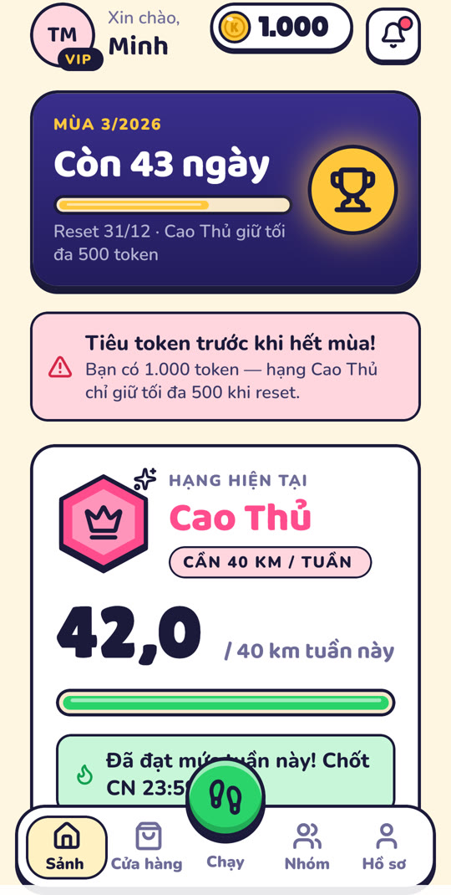 | 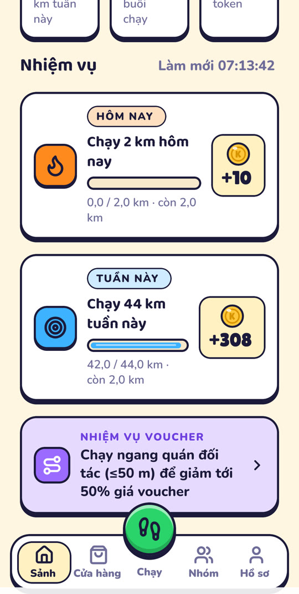 | 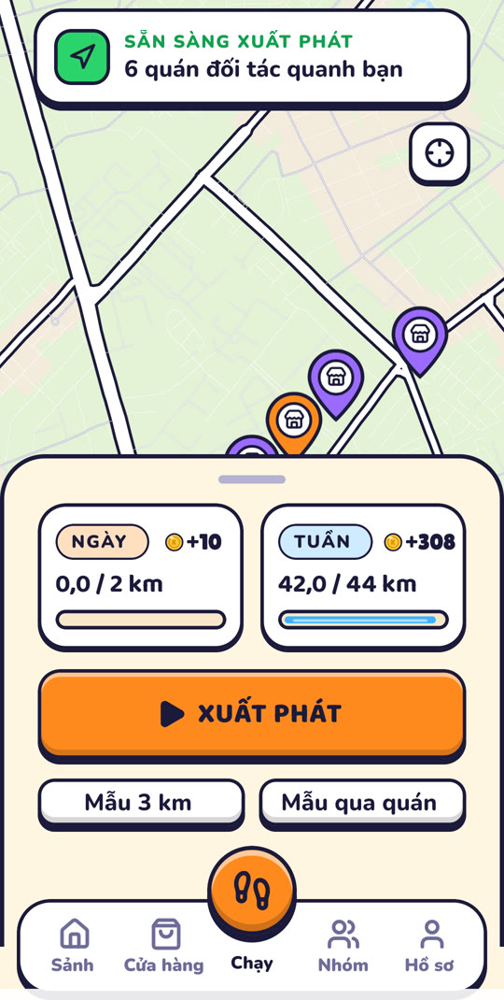 |
| **Kết thúc buổi chạy** | **Chọn quán để nhận giảm giá** | **Ví và giao dịch trên Fuji** |
|  | 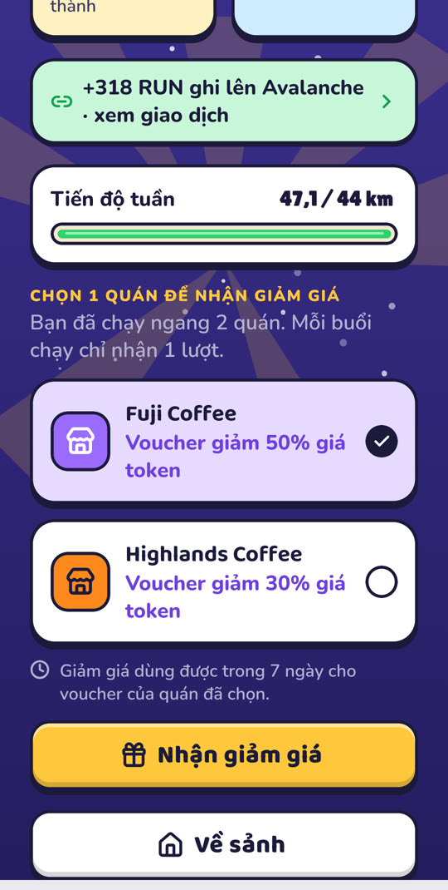 | 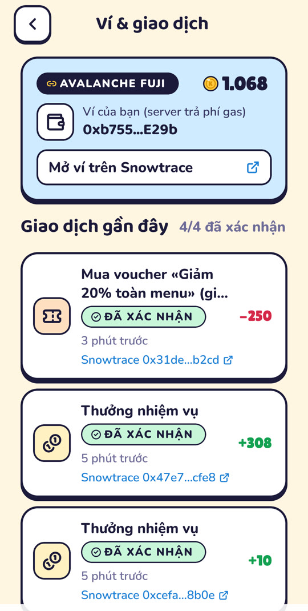 |

**Voucher: chạy ngang quán thì được giảm giá, mua rồi dùng bằng QR**

| Danh sách voucher | Giá còn 250 sau khi chạy ngang quán | Mã QR của voucher |
|:---:|:---:|:---:|
| 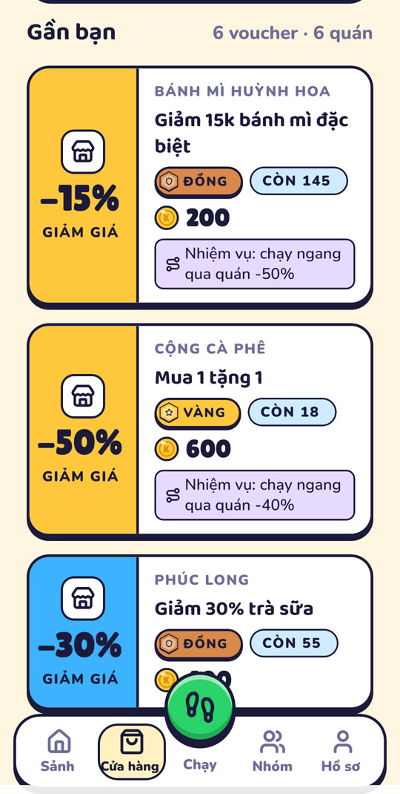 | 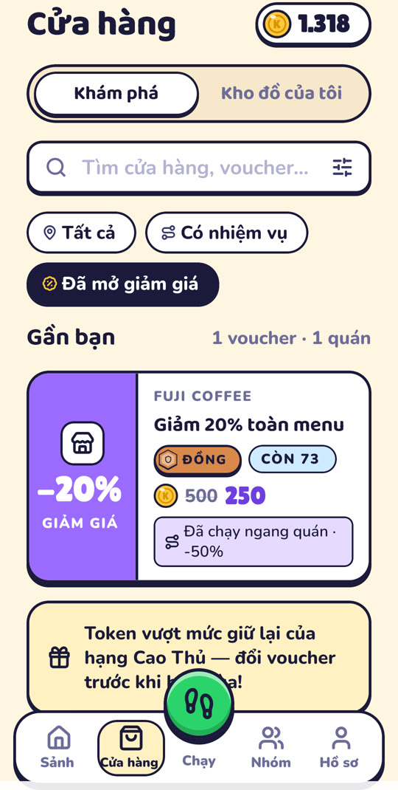 |  |

**Hội viên: nhóm chạy**

| Nhóm chạy | Chi tiết nhóm và điểm hội tụ | Hồ sơ và ví |
|:---:|:---:|:---:|
| 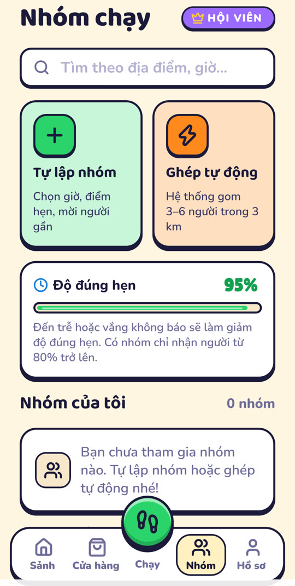 | 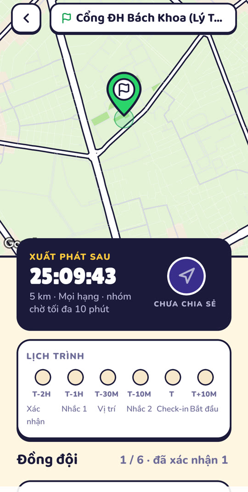 | 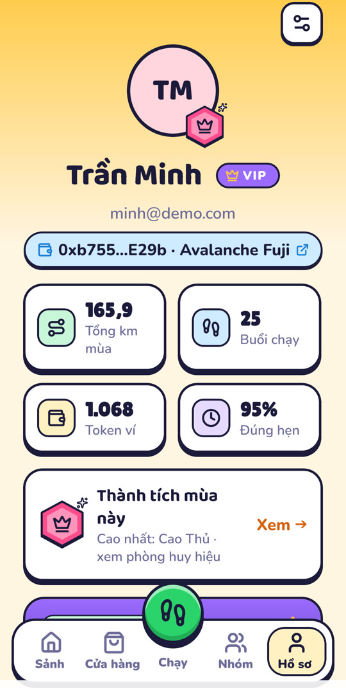 |

**Cửa hàng và quản trị**

| Tổng quan cửa hàng | Quét voucher thành công | Ví phí trả trước |
|:---:|:---:|:---:|
| 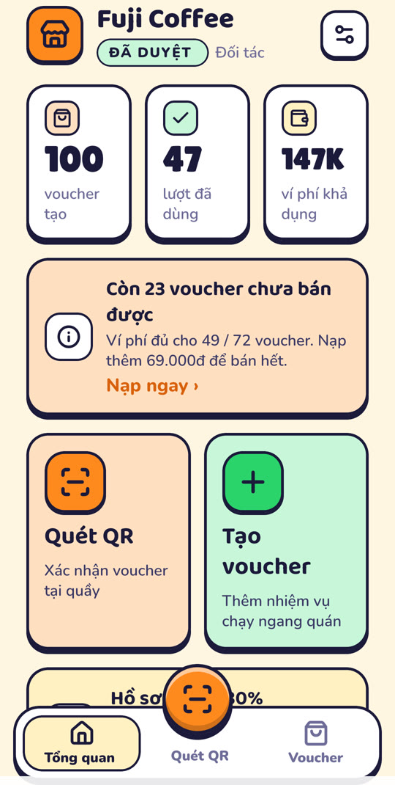 | 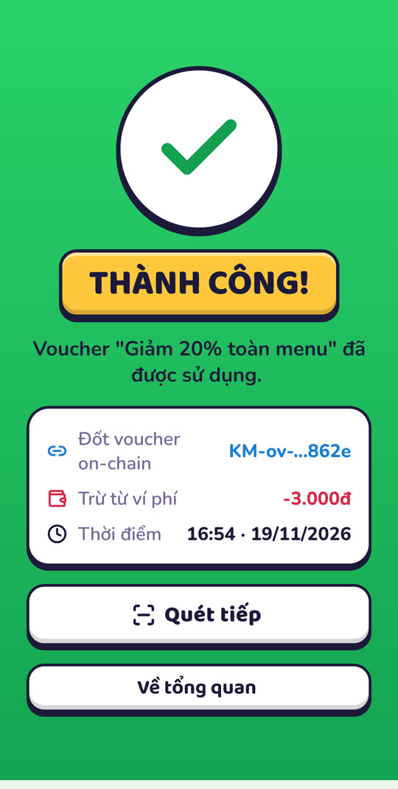 | 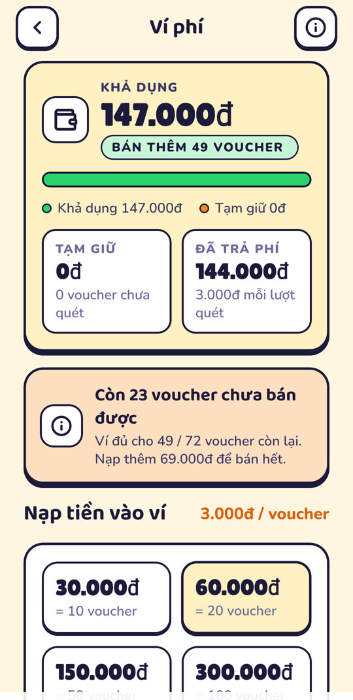 |
| **Quản trị: quản lý mùa** | **Người chạy: kết thúc mùa** | **Đăng nhập** |
| 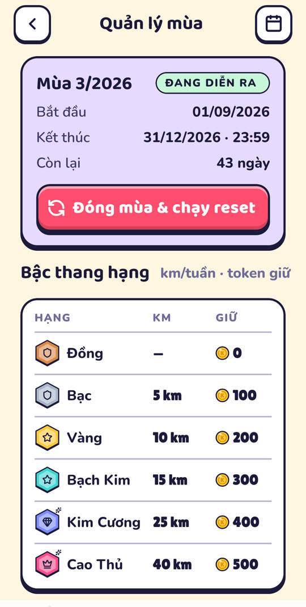 |  | 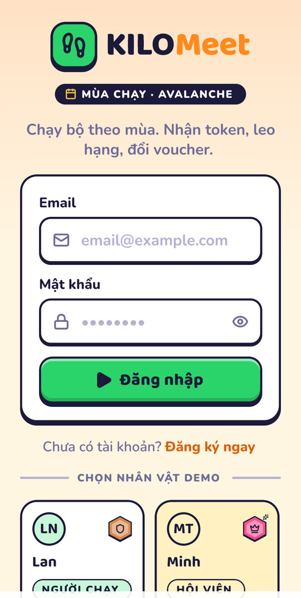 |

## Cần có

- **Máy tính:** Node 24, pnpm (`corepack enable pnpm`), Docker. Docker chỉ cần cho Cách 2.
- **Điện thoại Android hoặc iOS:** cài **Expo Go** bản mới nhất (hỗ trợ Expo SDK 58). Điện thoại phải dùng chung mạng Wi-Fi với máy tính.

## Cách 1: chỉ xem giao diện (không cần backend)

App dùng dữ liệu giả lập có sẵn, nên không có giao dịch on-chain thật.

```bash
cd kilomeet-app
pnpm install
cp .env.example .env.local     # để trống EXPO_PUBLIC_API_URL = dùng dữ liệu giả lập
pnpm start -c
```

Quét mã QR hiện trong terminal: Android quét bằng Expo Go, iOS quét bằng Camera.

## Cách 2: chạy đầy đủ với backend

**Bước 1: chạy backend**

```bash
cd kilomeet-api
cp .env.example .env           # mặc định CHAIN=fake: chạy được ngay, không cần khoá ví
docker compose up -d           # PostgreSQL 16 ở cổng 5433
pnpm install
pnpm demo:reset                # tạo bảng + nạp tài khoản demo
pnpm dev                       # API ở http://0.0.0.0:3000
```

Để kiểm tra backend đã chạy, mở `http://localhost:3000/health` trên trình duyệt.

**Bước 2: chạy app**

Tìm IP LAN của máy tính:
- Linux: `hostname -I`
- macOS: `ipconfig getifaddr en0`
- Windows: `ipconfig`

```bash
cd kilomeet-app
pnpm install
cat > .env.local <<'EOF'
EXPO_PUBLIC_API_URL=http://<IP LAN>:3000
EXPO_PUBLIC_DEMO=true
EOF
pnpm start -c
```

`EXPO_PUBLIC_DEMO=true` bật hai nút **Mẫu 3 km** và **Mẫu qua quán** ở tab Chạy. Hai nút này phát lại buổi chạy GPS ghi sẵn, nên không cần ra đường chạy thật để thử.

Muốn đưa dữ liệu về trạng thái ban đầu thì chạy lại `pnpm demo:reset` trong thư mục `kilomeet-api`.

## Tài khoản demo

Mật khẩu chung cho mọi tài khoản: `demo123`.

| Email | Vai trò |
|---|---|
| `lan@demo.com` | Người chạy (hạng Đồng, 0 token) |
| `minh@demo.com` | Hội viên (hạng Cao thủ, 1.000 token) |
| `an@demo.com`, `binh@demo.com` | Hội viên ở gần Minh, dùng để thử ghép nhóm |
| `quanfuji@demo.com` | Cửa hàng Fuji Coffee |
| `admin@demo.com` | Quản trị |

Cách 1 (dữ liệu giả lập) chỉ có 4 tài khoản: `lan`, `minh`, `quanfuji`, `admin`.

## Gặp lỗi khi chạy

| Hiện tượng | Cách xử lý |
|---|---|
| App báo "Không kết nối được máy chủ" | Kiểm tra điện thoại và máy tính có chung Wi-Fi không. Dùng IP LAN, không dùng `localhost`. Mở cổng 3000 trên tường lửa, ví dụ trên Linux: `sudo ufw allow 3000`. |
| Đã sửa `.env.local` nhưng app không đổi | Tắt Expo rồi chạy lại `pnpm start -c` |
| Expo Go báo không hỗ trợ SDK | Cập nhật Expo Go lên bản mới nhất |
| Cổng 5433 đang bị dùng | Tắt PostgreSQL khác đang chạy ở cổng đó |

## Chạy test tự động

```bash
cd kilomeet-api && pnpm typecheck && pnpm test   # 189 test backend (cần docker compose up -d)
cd blockchain && npm install && npm test         # 24 test hợp đồng
cd kilomeet-app && pnpm exec tsc --noEmit        # kiểm kiểu app
```

## Tài liệu

- [docs/KILOMeet.md](docs/KILOMeet.md): app làm gì, luật chơi, kịch bản demo
- [docs/backend-api-contract.md](docs/backend-api-contract.md): API giữa app và backend, các quyết định nghiệp vụ
- [docs/test-checklist.md](docs/test-checklist.md): danh sách tính năng để test thử từng màn hình
