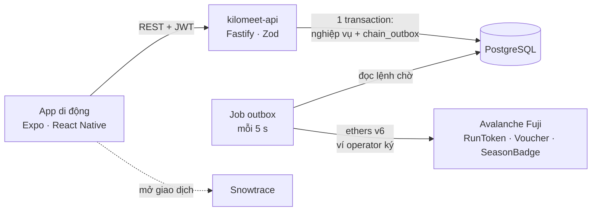

# KILOMeet: chạy bộ theo mùa trên Avalanche

**KILOMeet** là app chạy bộ theo mùa (UniHack 2026). Người chạy làm nhiệm vụ để nhận token **RUN**, leo hạng mỗi tuần, rồi dùng token mua voucher của quán đối tác. Chạy ngang qua quán thì được giảm giá. Cửa hàng trả phí mỗi lượt voucher được dùng. Hội viên được ghép nhóm chạy chung với người gần mình.

Token, voucher, lượt dùng voucher và huy hiệu mùa nằm trên **Avalanche C-Chain (Fuji)**. GPS, nhiệm vụ, hạng và ghép nhóm chạy trên máy chủ.

> 🎬 Video demo: _(điền link)_

## Vì sao dùng blockchain

| Vấn đề | Chuỗi bảo đảm |
|---|---|
| Quán sợ voucher bán quá số lượng hoặc bị dùng hai lần | `Voucher` (ERC-1155) đếm số đã bán, đốt voucher khi quét QR |
| Quán cần đối chiếu số lượt dùng trước khi trả phí | Mỗi lượt quét ghi sự kiện `VoucherRedeemed` kèm phí 5.000 đ |
| Người chạy cần tin token không bị tạo ra tuỳ ý hay xoá lén | `RunToken` (ERC-20, không chuyển được) chỉ mint khi có khoá thưởng duy nhất; reset mùa công khai trong **một giao dịch** cho mọi ví |
| Thành tích mùa | `SeasonBadge`: NFT soulbound ghi hạng cao nhất mỗi mùa |

Người dùng không cần ví hay AVAX: ví do server quản lý (custodial), ví server ký và trả gas cho mọi giao dịch.

### Hợp đồng trên Fuji (đã verify source)

| Hợp đồng | Địa chỉ |
|---|---|
| RunToken (ERC-20, decimals 0) | [`0x49D4915957E5a5f24F47593eeb979d0b91398225`](https://testnet.snowtrace.io/address/0x49D4915957E5a5f24F47593eeb979d0b91398225#code) |
| Voucher (ERC-1155) | [`0x22aB8C48f9Efd3dD37d8c11a6A1f3281d567215c`](https://testnet.snowtrace.io/address/0x22aB8C48f9Efd3dD37d8c11a6A1f3281d567215c#code) |
| SeasonBadge (ERC-721 soulbound) | [`0xf9C9eE06142D4AB0ae7b0f440AdAe725279eE8B0`](https://testnet.snowtrace.io/address/0xf9C9eE06142D4AB0ae7b0f440AdAe725279eE8B0#code) |

## Kiến trúc



- **DB là nguồn sự thật.** Mỗi thao tác đổi token hoặc voucher chạy trong một transaction, kèm một dòng `chain_outbox`. Job gửi giao dịch sau và lưu `txHash`, nên app không phải chờ chain.
- **Không phát trùng, không gửi trùng.** Khoá thưởng `keccak256(key)` bị hợp đồng từ chối nếu dùng lại. Outbox lưu `txHash` ngay khi giao dịch lên mạng; nếu tiến trình chết giữa chừng, lượt sau tra receipt chứ không gửi lại.
- **Không tin dữ liệu điện thoại.** BE tự tính km từ GPS (haversine, lọc tốc độ > 25 km/h), tự xét quán đi ngang (50 m) và quyền giảm giá. Trừ số lượng bằng `UPDATE … WHERE remaining > 0`.
- **Đóng mùa theo lô:** `endSeason` → `settleSeason(address[])` → `recordBadges(...)` → `startSeason`, tổng cộng 4 giao dịch cho mọi ví.

## Cấu trúc repo

```
kilomeet-app/   App di động: Expo 58, expo-router, NativeWind, Zustand. Runner · Cửa hàng · Quản trị
kilomeet-api/   Backend: Fastify, Prisma (PostgreSQL), Zod 4, Vitest. domain/ hàm thuần, modules/, chain/, jobs/
blockchain/     Hardhat + OpenZeppelin 5: 3 hợp đồng, test, script deploy, SDK
docs/           Nghiệp vụ, hợp đồng API, quy trình
```

## Chạy thử

Cần Node 24, pnpm, Docker.

```bash
# Backend
cd kilomeet-api
cp .env.example .env          # đặt JWT_SECRET; CHAIN=fake chạy không cần chain
docker compose up -d          # PostgreSQL 16, cổng 5433
pnpm install
pnpm demo:reset               # migrate + seed tài khoản demo
pnpm dev                      # http://0.0.0.0:3000

# App
cd ../kilomeet-app
pnpm install
echo "EXPO_PUBLIC_API_URL=http://<IP LAN của máy chạy BE>:3000" > .env.local   # bỏ trống = dùng mock
pnpm start                    # quét QR bằng Expo Go
```

Chạy với Avalanche Fuji: trong `kilomeet-api/.env`, đặt `CHAIN=fuji`, `SERVER_PRIVATE_KEY` (khoá ví operator) và `WALLET_MNEMONIC`. Sau đó chạy `pnpm demo:reset` rồi `pnpm chain:check` để đối chiếu số dư DB với chain. Chi tiết xem [`kilomeet-api/README.md`](kilomeet-api/README.md) và [`blockchain/README.md`](blockchain/README.md).

### Tài khoản demo (mật khẩu `demo123`)

| Email | Vai trò | Trạng thái |
|---|---|---|
| `lan@demo.com` | Người chạy | Đồng, 0 token |
| `minh@demo.com` | Hội viên | Cao thủ, 1.000 token |
| `quanfuji@demo.com` | Cửa hàng | Fuji Coffee, gần HCMUT |
| `admin@demo.com` | Quản trị | |

## Kịch bản demo 3 phút

1. Đăng nhập: ví Avalanche hiện ngay ở Hồ sơ.
2. Phát buổi chạy 3 km ghi sẵn: nhiệm vụ ngày đạt, **+10 RUN** được mint on-chain.
3. Tài khoản Cao thủ: hạng và số km còn thiếu để giữ hạng.
4. Voucher Fuji Coffee giá 500 token. Chạy 5 km ngang 2 quán, chọn Fuji: còn **250 token**.
5. Mua (đốt 250 RUN), rồi tặng cho tài khoản thứ hai.
6. Cửa hàng quét QR: voucher bị đốt, phí 5.000 đ ghi on-chain.
7. Hội viên ghép nhóm: bản đồ hiện từng người đang tới điểm hội tụ.
8. Quản trị đóng mùa: Cao thủ 1.000 → **500 token**, xuống Bạch kim, nhận huy hiệu NFT.

Bước nào có giao dịch đều có nút **Xem giao dịch**, mở danh sách giao dịch kèm trạng thái *Đang gửi lên chain → Đã xác nhận* và link Snowtrace.

## Kiểm thử

```bash
cd kilomeet-api && pnpm typecheck && pnpm test   # 174 test: domain, API, contract với FE, outbox
cd blockchain && npm test                        # 24 test hợp đồng
cd kilomeet-app && pnpm exec tsc --noEmit
```

## Tài liệu

- [Nghiệp vụ và luật chơi](docs/KILOMeet.md)
- [Hợp đồng API giữa app và backend](docs/backend-api-contract.md)
- [Hệ thống blockchain chi tiết](blockchain/HE-THONG-BLOCKCHAIN-KILOMEET.md)
