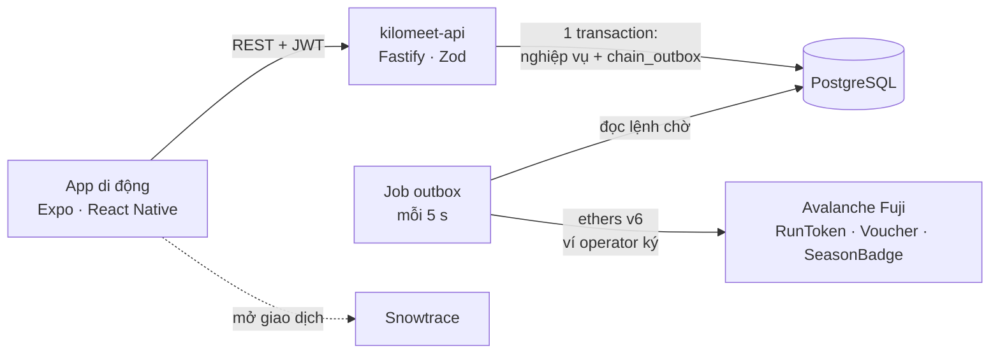

# KILOMeet: chạy bộ theo mùa trên Avalanche

**KILOMeet** là app chạy bộ theo mùa (UniHack 2026). Người chạy làm nhiệm vụ để nhận token **RUN**, leo hạng mỗi tuần, rồi dùng token mua voucher của quán đối tác. Chạy ngang qua quán thì được giảm giá. Cửa hàng trả phí mỗi lượt voucher được dùng. Hội viên được ghép nhóm chạy chung với người gần mình.

Token, voucher, lượt dùng voucher và huy hiệu mùa nằm trên **Avalanche C-Chain (Fuji)**. GPS, nhiệm vụ, hạng và ghép nhóm chạy trên máy chủ.

> 🎬 Video demo: _(điền link)_ · 📊 Slide: _(điền link)_

## Giám khảo nên xem gì trước

| Muốn xem | Ở đâu |
|---|---|
| App chạy thật trong 3 phút | Video demo ở trên, hoặc [Kịch bản demo](#kịch-bản-demo-3-phút) |
| Hợp đồng trên Fuji (đã verify source) | [Bảng địa chỉ](#hợp-đồng-trên-fuji-đã-verify-source), mở thẳng trên Snowtrace |
| Tự chạy app trên điện thoại | [Cách A](#cách-a-chỉ-xem-giao-diện-5-phút-không-cần-backend) mất 5 phút; [Cách B](#cách-b-đầy-đủ-với-backend-15-phút) chạy cả backend |
| Chất lượng code | [Kiểm thử](#kiểm-thử): 189 test backend, 24 test hợp đồng |
| Luật chơi đầy đủ | [docs/KILOMeet.md](docs/KILOMeet.md) |

## Vấn đề và người dùng

- **Người chạy bộ** khó giữ thói quen: chạy một mình, không có mục tiêu, không có phần thưởng thật. KILOMeet giao nhiệm vụ ngày và tuần, xếp hạng theo mùa, thưởng token đổi được voucher ở quán gần đường chạy. **Hội viên** được ghép nhóm với người chạy gần mình.
- **Quán cà phê, quán ăn** cần khách mới nhưng ngại khuyến mãi bị lạm dụng. Quán tự phát hành voucher và chỉ trả **3.000 đ mỗi lượt voucher được dùng**, trả trước qua ví phí. Mỗi voucher là token trên chain nên không bán quá số lượng, không dùng hai lần, và đối soát được.

### Hiện đã chạy được

| Vai trò | Tính năng |
|---|---|
| Người chạy | Đăng ký, ghi buổi chạy bằng GPS trên bản đồ, nhiệm vụ ngày/tuần, nhận token on-chain, hạng 6 bậc theo tuần, mua voucher (giảm giá khi đã chạy ngang quán), tặng voucher, xem ví và giao dịch trên Snowtrace |
| Hội viên | Tất cả tính năng trên, cộng ghép nhóm theo vị trí và khung giờ, xác nhận tham gia, theo dõi bản đồ hội tụ, điểm uy tín |
| Cửa hàng | Đăng ký chờ duyệt, tạo và quản lý voucher, quét QR để dùng voucher, ví phí trả trước (nạp, tạm giữ, trừ, trả lại), thống kê lượt dùng |
| Quản trị | Duyệt cửa hàng, theo dõi mùa, đóng mùa (reset token, xuống hạng, phát huy hiệu NFT) |

## Vì sao dùng blockchain

| Vấn đề | Chuỗi bảo đảm |
|---|---|
| Quán sợ voucher bán quá số lượng hoặc bị dùng hai lần | `Voucher` (ERC-1155) đếm số đã bán, đốt voucher khi quét QR |
| Quán cần đối chiếu số lượt dùng trước khi trả phí | Mỗi lượt quét ghi sự kiện `VoucherRedeemed` kèm phí 3.000 đ, khớp sổ ví phí trả trước |
| Người chạy cần tin token không bị tạo ra tuỳ ý hay xoá lén | `RunToken` (ERC-20, không chuyển được) chỉ mint khi có khoá thưởng duy nhất; reset mùa công khai trong **một giao dịch** cho mọi ví |
| Thành tích mùa | `SeasonBadge`: NFT soulbound ghi hạng cao nhất mỗi mùa |

Người dùng không cần ví hay AVAX: ví do server quản lý (custodial), ví server ký và trả gas cho mọi giao dịch.

### Hợp đồng trên Fuji (đã verify source)

| Hợp đồng | Địa chỉ |
|---|---|
| RunToken (ERC-20, decimals 0) | [`0x49D4915957E5a5f24F47593eeb979d0b91398225`](https://testnet.snowtrace.io/address/0x49D4915957E5a5f24F47593eeb979d0b91398225#code) |
| Voucher (ERC-1155) | [`0x22aB8C48f9Efd3dD37d8c11a6A1f3281d567215c`](https://testnet.snowtrace.io/address/0x22aB8C48f9Efd3dD37d8c11a6A1f3281d567215c#code) |
| SeasonBadge (ERC-721 soulbound) | [`0xf9C9eE06142D4AB0ae7b0f440AdAe725279eE8B0`](https://testnet.snowtrace.io/address/0xf9C9eE06142D4AB0ae7b0f440AdAe725279eE8B0#code) |

## Kiến trúc



- **DB là nguồn sự thật.** Mỗi thao tác đổi token hoặc voucher chạy trong một transaction, kèm một dòng `chain_outbox`. Job gửi giao dịch sau và lưu `txHash`, nên app không phải chờ chain.
- **Không phát trùng, không gửi trùng.** Khoá thưởng `keccak256(key)` bị hợp đồng từ chối nếu dùng lại. Outbox lưu `txHash` ngay khi giao dịch lên mạng; nếu tiến trình chết giữa chừng, lượt sau tra receipt chứ không gửi lại.
- **Không tin dữ liệu điện thoại.** BE tự tính km từ GPS (haversine, lọc tốc độ > 25 km/h), tự xét quán đi ngang (50 m) và quyền giảm giá. Trừ số lượng bằng `UPDATE … WHERE remaining > 0`.
- **Ví phí trả trước (quán):** mua voucher → giữ 3.000 đ trong ví quán (`UPDATE … WHERE khả dụng ≥ 3000`), quét → trừ, hết hạn → trả lại. Ví không đủ thì voucher "Tạm hết", nền tảng không bao giờ bị nợ phí.
- **Đóng mùa theo lô:** `endSeason` → `settleSeason(address[])` → `recordBadges(...)` → `startSeason`, tổng cộng 4 giao dịch cho mọi ví.

## Cấu trúc repo

```
kilomeet-app/   App di động: Expo 58, expo-router, NativeWind, Zustand. Runner · Cửa hàng · Quản trị
kilomeet-api/   Backend: Fastify, Prisma (PostgreSQL), Zod 4, Vitest. domain/ hàm thuần, modules/, chain/, jobs/
blockchain/     Hardhat + OpenZeppelin 5: 3 hợp đồng, test, script deploy, SDK
docs/           Nghiệp vụ, hợp đồng API, quy trình, checklist kiểm thử
```

## Chạy thử

**Cần có:**

- Máy tính: Node 24, pnpm (`corepack enable pnpm`), Docker (chỉ cần cho Cách B).
- Điện thoại Android hoặc iOS: cài **Expo Go** bản mới nhất (hỗ trợ Expo SDK 58), cùng mạng Wi-Fi với máy tính.

App đã được kiểm thử trên Android (Samsung Galaxy S23+).

### Cách A: chỉ xem giao diện (5 phút, không cần backend)

App có sẵn dữ liệu giả lập (mock) để xem đủ các màn hình. Ở cách này không có giao dịch on-chain thật.

```bash
cd kilomeet-app
pnpm install
cp .env.example .env.local     # để trống EXPO_PUBLIC_API_URL = dùng mock
pnpm start -c                  # quét QR bằng Expo Go (Android) hoặc Camera (iOS)
```

Đăng nhập bằng `lan@demo.com`, `minh@demo.com`, `quanfuji@demo.com` hoặc `admin@demo.com`, mật khẩu `demo123`.

### Cách B: đầy đủ với backend (15 phút)

**1. Backend**

```bash
cd kilomeet-api
cp .env.example .env           # mặc định CHAIN=fake: chạy được ngay, không cần khoá ví
docker compose up -d           # PostgreSQL 16 ở cổng 5433
pnpm install
pnpm demo:reset                # tạo bảng + nạp tài khoản demo
pnpm dev                       # API ở http://0.0.0.0:3000
```

Kiểm tra: mở `http://localhost:3000/health` trên trình duyệt.

**2. App**

Tìm IP LAN của máy tính: Linux dùng `hostname -I`, macOS dùng `ipconfig getifaddr en0`, Windows dùng `ipconfig`.

```bash
cd kilomeet-app
pnpm install
cat > .env.local <<'EOF'
EXPO_PUBLIC_API_URL=http://<IP LAN>:3000
EXPO_PUBLIC_DEMO=true
EOF
pnpm start -c                  # -c xoá cache để app đọc biến môi trường mới
```

`EXPO_PUBLIC_DEMO=true` bật nút **Mẫu 3 km** và **Mẫu qua quán** ở tab Chạy. Hai nút này phát lại buổi chạy GPS ghi sẵn quanh HCMUT, nên có thể thử nhiệm vụ, token và giảm giá khi đi ngang quán mà không cần ra đường chạy.

**Gặp lỗi khi chạy**

| Hiện tượng | Cách xử lý |
|---|---|
| App báo "Không kết nối được máy chủ" | Điện thoại và máy tính phải chung Wi-Fi. Dùng IP LAN, không dùng `localhost`. Mở cổng 3000 trên tường lửa, ví dụ `sudo ufw allow 3000` (Linux). |
| Sửa `.env.local` nhưng app không đổi | Tắt Expo rồi chạy lại `pnpm start -c` |
| Expo Go báo không hỗ trợ SDK | Cập nhật Expo Go lên bản mới nhất |
| `docker compose` báo cổng 5433 đang dùng | Tắt PostgreSQL khác đang chạy ở cổng đó, hoặc sửa cổng trong `docker-compose.yml` và `DATABASE_URL` |

### Cách C: với Avalanche Fuji

Cần khoá ví operator của hợp đồng, nên chỉ nhóm chạy được cách này. Nhóm dùng cách này khi quay video. Giám khảo có thể xem các giao dịch đã gửi trên Snowtrace theo địa chỉ hợp đồng ở trên.

Trong `kilomeet-api/.env`, đặt `CHAIN=fuji`, `SERVER_PRIVATE_KEY` và `WALLET_MNEMONIC`, rồi chạy `pnpm demo:reset` và `pnpm dev`. Chờ khoảng 1 phút để các giao dịch ban đầu lên chain, rồi chạy `pnpm chain:check` để đối chiếu số dư trong DB với chain. Chi tiết xem [kilomeet-api/README.md](kilomeet-api/README.md) và [blockchain/README.md](blockchain/README.md).

### Tài khoản demo (mật khẩu `demo123`)

| Email | Vai trò | Trạng thái ban đầu |
|---|---|---|
| `lan@demo.com` | Người chạy | Hạng Đồng, 0 token, chưa là hội viên |
| `minh@demo.com` | Hội viên | Hạng Cao thủ, 1.000 token, 42 km tuần này |
| `an@demo.com`, `binh@demo.com` | Hội viên | Ở gần Minh, để thử ghép nhóm |
| `quanfuji@demo.com` | Cửa hàng | Fuji Coffee gần HCMUT, ví phí 150.000 đ |
| `highlands@demo.com`, `phuclong@demo.com`, `cong@demo.com`, `banhmi@demo.com` | Cửa hàng | Quán đối tác đã duyệt |
| `juice@demo.com` | Cửa hàng | Ví phí 0 đ: voucher hiện "Tạm hết" |
| `newcafe@demo.com`, `juicebar@demo.com` | Cửa hàng | Đang chờ quản trị duyệt |
| `admin@demo.com` | Quản trị | |

Muốn đưa dữ liệu về trạng thái ban đầu thì chạy lại `pnpm demo:reset` trong `kilomeet-api`.

## Kịch bản demo 3 phút

1. Đăng nhập: ví Avalanche hiện ngay ở Hồ sơ.
2. Phát buổi chạy 3 km ghi sẵn: nhiệm vụ ngày đạt, **+10 RUN** được mint on-chain.
3. Tài khoản Cao thủ: hạng và số km còn thiếu để giữ hạng.
4. Voucher Fuji Coffee giá 500 token. Chạy 5 km ngang 2 quán, chọn Fuji: còn **250 token**.
5. Mua (đốt 250 RUN), rồi tặng cho tài khoản thứ hai.
6. Cửa hàng quét QR: voucher bị đốt, ví phí trả trước trừ 3.000 đ đã tạm giữ lúc bán, phí ghi on-chain. Màn **Ví phí**: nạp tiền, khả dụng, tạm giữ, "Còn N voucher chưa bán được".
7. Hội viên ghép nhóm: bản đồ hiện từng người đang tới điểm hội tụ.
8. Quản trị đóng mùa: Cao thủ 1.000 → **500 token**, xuống Bạch kim, nhận huy hiệu NFT.

Bước nào có giao dịch đều có nút **Xem giao dịch**, mở danh sách giao dịch kèm trạng thái *Đang gửi lên chain → Đã xác nhận* và link Snowtrace.

## Kiểm thử

```bash
cd kilomeet-api && pnpm typecheck && pnpm test   # 189 test: domain, API, contract với FE, outbox, ví phí (cần docker compose up -d)
cd blockchain && npm install && npm test         # 24 test hợp đồng
cd kilomeet-app && pnpm exec tsc --noEmit        # kiểm kiểu toàn bộ app
```

Kiểm thử thủ công trên điện thoại thật: đạt 147/153 mục trong [docs/test-checklist.md](docs/test-checklist.md).

## Giới hạn hiện tại

- Chưa thử ghi GPS khi chạy ngoài trời thật. Phần tính km, đi ngang quán và nhiệm vụ đã được kiểm bằng buổi chạy ghi sẵn và test tự động.
- Nạp tiền vào ví phí của quán là thanh toán giả lập, chưa nối cổng thanh toán thật.
- Ví người dùng do server quản lý (custodial) để người dùng không phải cầm khoá hay trả gas.
- Hợp đồng đang chạy trên testnet Fuji, chưa lên mainnet.

## Tài liệu

- [Nghiệp vụ và luật chơi](docs/KILOMeet.md)
- [Hợp đồng API giữa app và backend](docs/backend-api-contract.md)
- [Hệ thống blockchain chi tiết](blockchain/HE-THONG-BLOCKCHAIN-KILOMEET.md)
- [Checklist kiểm thử](docs/test-checklist.md)
